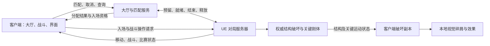

# Project FPS 设计总览

本项目使用 Unreal Engine 制作第一人称联机 FPS，以团队竞技为主要模式，通过破坏掩体、墙面和部分楼板改变交战路线。玩法参考《Call of Duty》的团队竞技，破坏表现参考《THE FINALS》。

项目逻辑采用 C++ + Lua：C++ 实现引擎接入、网络契约、状态存储与密集计算，Lua 实现客户端玩法流程及战斗服务端玩法规则，已引入腾讯 UnLua，待完成两端运行包验证。美术方向已选择立体纸模型，突出纸板层次、折面与裁切边缘，手绘线条作为辅助。具体分工见[客户端设计](02-client.md)和[服务端设计](03-server.md)。

## 1. 文档入口与约定

| 文档 | 内容及负责定义的事项 |
| --- | --- |
| 本文 | 项目边界、技术选型、M1～M5 开发路线图、阶段验收与待定事项 |
| [玩法设计](01-gameplay.md) | 对局规则、武器与重生、地图和破坏的玩法作用 |
| [客户端设计](02-client.md) | 输入、预测反馈、界面、表现与渲染路径 |
| [服务端设计](03-server.md) | 权威逻辑、状态归属、通信约定与部署 |
| [破坏系统设计](04-destruction.md) | 破坏资产、物理与同步分层、性能预算及实验 |
| [M1 与 M2 具体工作清单](../Tasks/05-m1-m2-checklist.md) | 按客户端／服务端及 M1／M2 整理第 6.3 节相关任务，保留原编号与本端阶段边界 |

本文中的“首版”均指课程验收 Demo。玩法数值集中在玩法文档，通信规则集中在服务端文档，破坏专有状态集中在破坏文档，其他文档仅引用。

| 状态 | 内容 |
| --- | --- |
| 已明确 | 课程 Demo；UE 原生客户端；第一人称联机团队竞技；基于 Chaos 探索实时破坏性能优化；采用五份核心设计文档，并配套 M1／M2 工作清单 |
| 已确认的联机基线 | 4～8 人；UE Dedicated Server；沿用局域网作为开发基线，本轮 Demo 是否必须公网验收待确认 |
| 已确认的玩家流程 | 进入大厅 → 点击匹配 → 自动凑人分队 → 进入战斗 → 结算 → 返回大厅 → 再次匹配 |
| 已确认的破坏范围 | 指定墙体、掩体和部分楼板可破坏，支持局部坍塌 |
| 已确认的新增方向 | 采用 C++ + Lua 的逻辑分工，Lua 参与两端玩法逻辑；制作纸模手绘风格 Shader；以立体纸模型方向 A 为视觉基准 |
| 已确认的团队安排 | 5 人团队；1 人专门负责纸模地图与 Shader；其余 4 人协作开发，主负责人同时参与客户端和服务端；具体模块负责人待认领 |
| 技术候选 | UnLua 与 UE 5.8.3 的编译、运行、脚本打包及 Server 构建兼容性；材质原型与 Nanite／破坏资产的配合 |
| 建议参数 | Windows PC；一张小型地图；具体玩法数值与性能目标 |
| 待确认 | 交付时间与具体模块分工；公网验收要求；账号与跨局战绩是否必做；大厅是否需要可走动空间 |

## 2. 首版范围

交付一个完整的“启动客户端 → 进入大厅 → 点击匹配 → 自动凑人分队 → 加载战斗场景 → 开战 → 击杀与重生 → 破坏改变路线 → 结算 → 返回大厅 → 再次匹配”循环。地图包含可重复触发的破坏展示区域，支持同一场景下优化前后的性能比较。

| 首版包含                                       | 暂不包含                                 |
| ------------------------------------------ | ------------------------------------ |
| 两队对抗，一张地图，一种步枪、一种手雷                        | 战役、机器人对战、职业技能、配装成长                   |
| 指定构件的预破碎资产与运行时断裂、坍塌                        | 任意网格切割、整张地图无限破坏、通用建筑结构力学求解           |
| 大厅、自动匹配、取消匹配、服务器分配、入场失败提示；固定地址直连仅供早期联调     | 好友组队、段位匹配、排行榜；账号与跨局战绩待确认，暂不作为开发前置    |
| 服务器判定命中、伤害、胜负与关键破坏                         | 正式反作弊、历史命中回溯、主机迁移                    |
| 每局重置地图；结算后返回大厅，再次匹配进入新局                    | 对局中途加入、自动断线重连、跨局保存废墟                 |
| Lua 驱动的两端玩法流程、服务端规则与客户端界面；纸模材质与自定义 HLSL 效果 | Lua 重写物理求解／底层网络；在线脚本分发；自研完整着色模型或渲染管线 |

大厅首版建议采用场景背景与匹配 UI；服务端按大厅／匹配和 UE 战斗两部分划分职责。匹配先采用单一模式、按排队顺序凑人，战斗服务器按人数均衡分队。先使用固定数量的战斗服务器，容量不足时保留排队并显示状态；不将自动扩缩容作为 Demo 前置。

## 3. 技术方案

| 项目 | 方案 | 选择原因 |
| --- | --- | --- |
| 引擎版本 | 固定 UE 5.8 的同一补丁版本；本机日志为 5.8.3 | 减少资产、复制和 Chaos 行为差异 |
| 开发方式 | C++ 网络接口、复制状态、移动与物理计算；Lua 两端玩法流程及服务端规则；配置使用数据资产 | 以计算规模、引擎耦合和迭代需求划分职责 |
| Lua 接入 | 客户端与 Dedicated Server 均嵌入 UnLua；验证后固定插件提交与 Lua 版本 | 利用原生类绑定、反射访问与事件回调实现脚本层 |
| 对局架构 | UE 权威 Dedicated Server | 共享场景与碰撞数据，独立测量服务器性能 |
| 大厅与匹配 | 轻量大厅／匹配服务负责会话、队列、分配与超时；语言、通信协议及具体部署待定 | 将入场流程与实时战斗分开，先支撑固定数量的战斗实例 |
| 角色与网络 | CharacterMovement；普通 Actor 属性复制、RepNotify、RPC | 复用移动预测和基础复制，减少外围实现 |
| 破坏 | Chaos Geometry Collection、预破碎层级、Field／应变输入 | 用可控资产组织实现交互式破坏 |
| 渲染 | 原生 Geometry Collection；目标 PC 上评估 Nanite；重复视觉碎屑可用 ISM | 复用变换批量更新与实例渲染 |
| 风格 Shader | 内置受光材质 + 共享材质函数／局部 Custom HLSL；纸纹、断面层纹与手绘边缘 | 保留光影与立体感，控制引擎改动范围 |
| 分析工具 | Unreal Insights、Networking Insights、GPU 分析工具；Chaos Visual Debugger 辅助检查 | 分别定位 CPU、网络、GPU 与物理状态问题 |

关键原则：服务器决定玩法事实；客户端立即提供操作反馈；视觉碎屑允许差异，但不得改变通行、射击阻挡或伤害结果。服务端 Lua 是权威规则的一部分，客户端 Lua 只能请求操作；权威边界由执行端决定，语言分工不改变该边界。

## 4. 验收与性能基线

功能验收应覆盖大厅匹配到战斗结算再返回大厅的完整流程、取消和入场失败、服务器伤害判定、破坏后通行与射击阻挡一致，以及连续多局地图重置。性能需在明确硬件、分辨率、画质、客户端数量、引擎构建配置之后测试。

| 指标 | 首轮测试目标，待硬件基线后锁定 |
| --- | --- |
| 客户端 | 1080p 固定画质，以 60 FPS 为目标；记录 CPU/GPU 帧时间、P95/P99、超过 50 ms 的帧数 |
| 服务器 | 先以 30 Hz 推进对局；记录每步工作耗时 P95/P99 和超过 33.3 ms 的次数，预留余量 |
| 破坏性能 | 记录断裂、碰撞／求解、变换整理、GPU 渲染和网络发送开销，不只看平均 FPS |
| 破坏质量 | 记录从攻击生效到关键结构变化的延迟、穿透／抖动和各端结构不一致情况 |
| 网络 | 局域网基线；另做约 80 ms RTT、抖动及 1% 丢包的健壮性测试，明确模拟参数 |
| Lua 与风格效果 | 验证两端分发包可加载对应脚本、服务端规则可更新并复制状态、切局清理正常；测量跨语言调用／垃圾回收与 Shader 开销，检查纸纹稳定及断面效果 |

30 Hz 服务端更新、物理步长、客户端渲染频率和对象复制频率不是同一个参数。先分别记录，再调整；性能数据均为待测，不填写未经测试的提升百分比。

## 5. 客户端与服务端开发路线图

M1 → M2 → M3 → M4 → M5 表示整体验收顺序，各模块在接口和依赖明确后可同时推进，客户端与服务端围绕同一可玩功能一起联调。以下均为计划与待验收项，不因文档、Target 或插件存在而视为完成。团队为 5 人，其中 1 人专门负责纸模地图与 Shader；其余 4 人包含同时参与两端的主负责人。每阶段保留构建标识、启动方法、测试人数和验收记录；具体模块负责人及日期在任务认领与工期确认后补充。

| 阶段 | 客户端交付 | 服务端交付 | 通过条件 |
| --- | --- | --- | --- |
| M1：最小战斗闭环 | 移动、瞄准、步枪、换弹、生命与弹药 HUD、死亡反馈 | 开火校验、命中与伤害、弹药、死亡、重生与保护 | 两人可以持续对战，伤害与重生由服务器决定，无重复击杀或死亡后攻击 |
| M2：完整单局玩法 | 等待、倒计时、比分、记分板、结算界面 | 自动分队、比赛阶段、计分、胜负、中止、地图重置 | 能按分数或时间结束一局；清除旧状态后开始下一局；覆盖玩家离开 |
| M3：大厅与自动匹配 | 大厅、匹配／取消、加载、失败提示、结算后返回大厅 | 玩家会话、队列、实例预留、入场资格、连接超时、实例释放 | 从大厅匹配完成一局，返回后可再匹配；失败不会遗留队列或长期占用实例 |
| M4：特色玩法与表现 | 手雷反馈、纸模地图与 Shader、破坏表现、音效 | 手雷伤害、墙体／楼板破坏、局部坍塌、关键碰撞同步 | 破坏实际改变交战路线；所有玩家认可同一通路与射击遮挡；地图可重置 |
| M5：Demo 验收与课程交付 | 加载与异常恢复、性能调整、客户端发布包及操作说明 | 连续对局稳定性、断线清理、日志、部署启动流程及服务端发布包 | 4～8 人多机连续多局通过；完成固定场景性能对照、演示流程、设计文档及实验结果 |

### 6.1 阶段任务与依赖

**M1：建立持续可玩的战斗。**

- [ ] 完成角色与武器输入、本地开火反馈、权威射击／换弹和 HUD，接入比赛、生命期及请求去重校验。
- [ ] 完成死亡、出生点选择、重生保护和装备恢复；连续死亡／重生后无旧计时器、委托或攻击残留。
- [ ] 使用两客户端验证公共生命／死亡结果一致，各自可见的弹药与服务器一致，并覆盖拒绝非法请求的路径。

**M2：补齐一局的规则。**

- [ ] 完成 GameMode／GameState／PlayerState 的规则与状态分工，以及 Lua 驱动的分队、阶段流转和胜负。
- [ ] 完成等待、倒计时、计时、比分、结算和退出中止；具体数值以[玩法设计](01-gameplay.md)为准。
- [ ] 验证地图重置和新 RoundId。此阶段可用直连后的循环开局测试；最终玩家流程在 M3 改为结算返回大厅、重新匹配。

**M3：接通正式入口与返回流程。**

- [ ] 实现大厅场景／UI、玩家会话、排队与取消；每名玩家最多存在一份有效排队或入场分配。
- [ ] 实现固定战斗实例的登记、就绪检查、预留与释放；分配名单和入场资格由服务端维护，客户端不能自定入场身份。
- [ ] 完成加载入场、等待名单就绪、失败退回与结算回大厅；验证取消与分配同时发生、玩家未到齐、实例失联和旧回调到达。

**M4：完成特色内容。**

- [ ] 接入权威手雷，引信、角色伤害与结构破坏遵守既定顺序；实现掩体、墙面、楼板和指定坍塌区域的破坏。
- [ ] 完成一张纸模风格地图、外表面与破碎断面材质、音效及视觉碎屑预算；保证出生区与地图边界安全。
- [ ] 验证连续爆炸、关键块碰撞、两端一致性和下一局恢复；关键结构不稳定时先收缩动态残骸交互与坍塌规模。

**M5：形成可交付运行包。**

- [ ] 以同一已验证构建完成 4～8 人多机连续多局，记录匹配、取消、加载失败、掉线、中止、正常结算和再次匹配结果。
- [ ] 完成[破坏系统设计](04-destruction.md)规定的固定输入、多轮对照实验，记录 CPU／GPU／物理／网络与一致性结果；不以性能改善掩盖功能退化。
- [ ] 交付客户端与服务端运行包、大厅／匹配服务运行产物及配置、启动停止方法、操作说明、演示流程、五份设计文档、配套工作清单和实验结果。

大厅界面、灰盒地图及材质原型可在对应接口明确后提前制作；战斗服务器分配须等独立实例就绪与重置验证通过。破坏内容在 M4 完成，性能实验与课程材料纳入 M5。

### 6.2 待确认事项

| 事项          | 当前处理方式                                            | 对路线图的影响                          |
| ----------- | ------------------------------------------------- | -------------------------------- |
| 联网验收范围      | 继承局域网开发基线；是否要求不同网络玩家公网联机待确认                       | 若要求公网，M3／M5 纳入公网连接、部署与异常验收       |
| 交付时间与具体模块分工 | 已确认 5 人及地图／Shader 专人；其余任务先按第 6.3 节拆解，不预填日期或人员能力判断 | 按模块认领主责与协作项，再安排阶段时间              |
| 账号与跨局战绩     | 尚未确认；暂按临时玩家会话支撑匹配                                 | 若必做，补身份认证、数据持久化及其验收；单局结算仍为必做     |
| 大厅表现        | 暂按场景背景与匹配 UI 规划                                   | 若要求可走动多人空间，另补大厅角色同步与交互工作         |
| 匹配参数与部署技术   | 单模式、先到先匹配、固定实例数量作为建议；目标人数与各超时可配置                  | M3 实现前锁定协议、配置及失败处理；不能用界面模拟代替真实匹配 |
| 硬件与性能阈值     | 先采集基线，保留第 5 节目标                                   | M5 前锁定测试环境和正式通过条件                |

### 6.3 可认领的功能与模块清单

以下按功能职责拆成 F01～F12，共 12 个模块、60 项任务。它们是任务边界，不要求创建 12 个 UE Runtime 模块、插件或独立进程。每行任务可以单独认领；细则及数值仍以玩法、客户端、服务端和破坏文档为准。

需要按端和阶段认领 M1、M2 工作时，使用[M1 与 M2 具体工作清单](05-m1-m2-checklist.md)；该清单保留本节原编号，范围调整需同步维护。

除已确认由专人负责的 F11 外，具体人员分配暂留空。主负责人贯穿客户端与服务端，参与公共接口、关键链路和联调，也可认领具体任务；各模块主责仍对自身实现、网络同步和验收负责。

**F01：客户端启动、大厅与场景流程（骨架可提前，M3 完成）。**

| 任务 | 具体实现 | 端与边界 |
| --- | --- | --- |
| F01-01 启动与大厅 | 启动进入大厅地图，创建界面，建立玩家会话并显示服务可用状态 | 客户端；会话请求由 F02 适配层提供 |
| F01-02 匹配交互 | 匹配按钮、排队状态、取消处理中、分配结果、重复点击限制及失败提示 | 客户端；服务端决定是否已入队或取消 |
| F01-03 加载与入场 | 使用分配地址和资格发起连接，显示加载／入场等待；当前世界和玩家控制就绪后报告状态 | 客户端；入场校验由 F03 负责 |
| F01-04 返回大厅 | 正常结算、主动退出、连接失败后恢复大厅；清理战斗 UI、旧连接和回调 | 客户端；返回后允许重新匹配 |
| F01-05 跨地图状态 | 用 GameInstance／其 Subsystem 保存会话和当前请求，区分客户端流程与服务器比赛阶段，丢弃旧分配回调 | 客户端；地图与控件不单独维护匹配真值 |

完成标准：通过真实服务实现大厅 → 匹配 → 入场 → 结算 → 大厅，取消后旧结果不会再次触发切图。依赖：F02、F03、F08；UI 可用约定的模拟响应提前制作。

**F02：玩家会话与匹配服务（接口可提前，M3 完成）。**

| 任务 | 具体实现 | 端与边界 |
| --- | --- | --- |
| F02-01 临时玩家会话 | 分配玩家标识、维护有效会话与版本信息，处理失效和重复请求 | 大厅服务；账号登录仍为待确认范围 |
| F02-02 排队与取消 | 单模式队列、目标人数配置、按顺序凑人、取消与断线移除、限制重复排队 | 大厅服务；无实例容量时保持排队 |
| F02-03 创建分配 | 预留实例、创建 MatchId 和固定名单、取得就绪确认、发放短期入场资格 | 大厅服务；调用 F03 的实例与接入能力 |
| F02-04 状态与竞争 | 提供排队／分配／失败结果，处理取消与分配竞争、重复通知、过期记录和服务重启 | 大厅服务；按当前请求和 MatchId 裁决 |
| F02-05 UE 通信适配 | 封装建立会话、排队、取消、查询或接收状态、超时及错误映射，向 F01 暴露统一接口 | 客户端原生适配与 Lua 调用入口；协议待选型 |

完成标准：配置人数的玩家获得同一有效分配；重复请求不重复占位，取消、失效和失败后可重新匹配。依赖：F03 的实例登记与预留接口。

**F03：战斗实例管理与入场（M3 完成接入）。**

| 任务 | 具体实现 | 端与边界 |
| --- | --- | --- |
| F03-01 实例登记 | 配置固定数量的 UE 服务器及地址／版本，登记就绪和存活状态 | 大厅服务与 UE 服务端；不要求自动扩缩容 |
| F03-02 占用与释放 | 可用、预留、入场、比赛、清理、不可用状态；防止同一实例同时分配两局 | 大厅服务维护分配事实，UE 报告实际状态 |
| F03-03 入场校验 | 校验玩家会话、资格、MatchId、名单、有效期与版本；拒绝越权和重复占用 | UE 服务端接入适配；GameMode 接入位置与 F08 协调 |
| F03-04 名单就绪 | 汇总实际入场与就绪状态，处理人数未齐、加载超时和开战前退出 | 服务端；全部满足后通知 F08，客户端报告不替代服务端入场检查 |
| F03-05 失败与恢复 | 实例失联、准备失败、旧通知、结算清场、重置失败处理；重置确认后再开放实例 | 服务端；与 F08 协调地图重置和结束通知 |

完成标准：资格错误者无法加入；一台实例不承接重叠分配；入场失败可释放预留，旧局清理后才能再次使用。依赖：F02 的分配契约及 F08 的阶段通知。

**F04：角色操控与第一人称体验（M1）。**

| 任务 | 具体实现 | 端与边界 |
| --- | --- | --- |
| F04-01 输入与镜头 | 移动、鼠标观察、跳跃、冲刺、瞄准，游戏／菜单输入模式切换 | 客户端输入；复用既定输入与角色系统 |
| F04-02 移动同步 | 标准角色移动、冲刺状态、服务器校正和远端平滑 | 两端；使用 CharacterMovement 原生路径 |
| F04-03 角色呈现 | 本地第一人称手臂／武器、远端身体、队伍识别、基础移动与瞄准表现 | 客户端；外观与权威命中碰撞分开 |
| F04-04 行为限制 | 死亡、等待、结算、菜单状态下的输入规则，冲刺与攻击互斥及状态恢复 | 两端；服务器仍检查攻击资格 |

完成标准：两端能稳定观察彼此移动，死亡和比赛阶段切换正确限制操作。依赖：F08、F06 的阶段与生命状态接口，可先提供最小实现。

**F05：步枪、弹药与换弹（M1）。**

| 任务 | 具体实现 | 端与边界 |
| --- | --- | --- |
| F05-01 武器配置与装备 | 一种步枪的伤害、射速、弹匣、备用弹药、换弹时间、射击距离及表现引用，出生时装备 | 原生数据定义；F06 重生时调用初始化 |
| F05-02 本地射击 | 按下／松开射击、连续开火节奏、瞄准、后坐力、枪口与声音，拥有者效果去重 | 客户端表现与请求；命中提示等待权威确认 |
| F05-03 权威开火 | 请求归属、轮次／生命期、编号去重、存活、阶段、弹药、射速及瞄准范围校验 | UE 服务端 C++ 入口与 Lua 规则 |
| F05-04 命中与反馈 | 服务器构造射线，查询玩家与环境，将伤害交给 F06，复制弹药并发出命中／开火反馈 | 两端；首版不实现普通子弹破坏墙体 |
| F05-05 换弹与中断 | 判断可换弹、开始／结束计时、弹药转移、禁止换弹期间射击；死亡或切局时中断并清理 | 服务端提交权威状态，客户端显示进度和动作 |

完成标准：射击与换弹消耗准确；无弹药、死亡或阶段不允许时请求无效；丢包时最终弹药与服务器一致。依赖：F04、F06、F08 的最小状态与接口。

**F06：生命、伤害、死亡与重生（M1，M2 接入正式比赛规则）。**

| 任务 | 具体实现 | 端与边界 |
| --- | --- | --- |
| F06-01 生命与伤害入口 | 权威生命、存活、伤害来源；统一处理步枪、手雷和必要的环境死亡 | UE 服务端；客户端消费复制状态 |
| F06-02 伤害规则 | 敌我过滤、手雷自身伤害、重生保护、已死亡目标过滤与伤害结果 | Lua 决策，原生检查与提交；数值以玩法文档为准 |
| F06-03 死亡事件 | 停止角色能力，记录致死来源，按生命期只产生一次有效死亡事件 | 通知 F08 计分，通知 F04／F05／F09 更新行为与表现 |
| F06-04 重生调度 | 管理重生计时、选择己方安全出生点、生成／控制新角色、分配新 LifeId、恢复装备 | 服务端；F08 提供队伍与阶段许可，不另设第二套重生计时器 |
| F06-05 保护与取消 | 重生保护计时、主动攻击后取消保护、比赛结束时停止待执行重生 | 两端显示与服务端校验；计时器归本模块管理 |

完成标准：连续死亡／重生后生命与装备正确，旧 LifeId 请求无效，结束后无角色被旧计时器再次生成。依赖：F04 的角色、F05 的装备初始化、F08 的队伍和阶段接口。

**F07：手雷与爆炸（M4，接口可提前）。**

| 任务 | 具体实现 | 端与边界 |
| --- | --- | --- |
| F07-01 投掷请求 | 输入、库存显示、预备动作、投掷资格和次数校验 | 两端；权威库存由服务端保存 |
| F07-02 手雷实体 | 服务器生成复制 Actor、设置初始运动与碰撞，客户端展示轨迹；无需新增预测回滚系统 | UE 两端；生成位置和速度由服务端约束 |
| F07-03 引信与爆炸 | 服务器计时并只引爆一次，生成唯一事件标识，清理手雷实体 | UE 服务端 |
| F07-04 角色伤害 | 先按爆炸发生时的结构查询范围、距离衰减和遮挡，再经 F06 统一提交伤害 | UE 服务端；同次爆炸新开的缺口不额外穿墙伤人 |
| F07-05 结构请求与表现 | 完成角色伤害查询后向 F10 提交独立结构损伤参数；播放爆炸、声音和扬尘 | 服务端发起破坏，客户端消费确认结果 |

完成标准：手雷不重复扣减或引爆，遮挡、伤害和破坏顺序正确，所有玩家看到一致的玩法结果。依赖：F05／F06 的攻击与伤害约定、F10 的破坏入口。

**F08：团队竞技与比赛生命周期（M2，M3 接入匹配）。**

| 任务 | 具体实现 | 端与边界 |
| --- | --- | --- |
| F08-01 公共比赛状态 | GameMode 规则、GameState 比分／阶段／截止时间、PlayerState 队伍及击杀死亡；创建 RoundId | UE 服务端保存，客户端接收所需状态 |
| F08-02 分队与开局 | 根据有效名单均衡分队，等待就绪、开始／取消倒计时，启用战斗和初始出生 | M2 使用联调名单，M3 对接 F03 |
| F08-03 计分与胜负 | 消费 F06 的死亡事件，处理有效击杀、自杀、环境死亡、分数上限、时间结束与平局 | Lua 规则与原生状态提交；同一死亡只计分一次 |
| F08-04 退出与结算 | 玩家退出、空队中止、停止攻击和重生、生成单局结果并通知客户端展示 | UE 服务端；跨局战绩持久化仍待确认 |
| F08-05 清场与重置 | 清理角色、手雷、计时器，重载地图；通知返回大厅及实例可用，与 F03 对齐状态 | 服务端统筹，客户端 F01 执行返回；F10 验证破坏恢复 |

完成标准：分数结束、时间结束、平局、中止均可到达正确结算；下一局得分、角色与破坏状态干净。依赖：F06 的死亡事件、F09 的展示；M3 起依赖 F03。

**F09：战斗 HUD、反馈与结算展示（M1～M2，M4 补完整表现）。**

| 任务 | 具体实现 | 端与边界 |
| --- | --- | --- |
| F09-01 战斗 HUD | 准星、生命、弹匣与备用弹药、手雷数、换弹状态 | 客户端原生 UMG 接口与 Lua 流程；读取 F05／F06／F07 |
| F09-02 比赛与记分板 | 队伍、双方比分、服务器剩余时间、玩家击杀／死亡、等待和开局提示 | 客户端读取 F08，不独立判定比赛结束 |
| F09-03 受击与死亡 | 服务器确认的命中反馈、受伤反馈、死亡倒计时、重生保护提示 | 客户端；生命和计时来源于权威状态 |
| F09-04 菜单与结算 | Esc 菜单、退出操作、比赛结果、结算倒计时、返回大厅入口 | 退出与切图交给 F01／F08；菜单不暂停服务器 |
| F09-05 表现与绑定清理 | 界面刷新事件、音效触发、重复回调防护、死亡／重生／切图后的解绑与重建 | 客户端；与武器及破坏表现区分触发归属，避免重复播放 |

完成标准：HUD 与权威状态一致，重生和切图后无残留控件或重复回调；结算后能返回大厅。依赖：F01、F05～F08；控件可用模拟数据提前制作。

**F10：场景破坏、同步与碎屑（M4 完整，M5 实验）。**

| 任务 | 具体实现 | 端与边界 |
| --- | --- | --- |
| F10-01 可破坏构件 | 组织墙体、掩体、楼板，制作 Geometry Collection 破碎层级、锚定、连接和简化碰撞，登记标识 | 程序与资产配置；原始模型和材质由 F11 提供 |
| F10-02 权威破坏入口 | 接收爆炸事件、筛选范围构件、检查重复与轮次、施加结构损伤并更新版本 | 服务端；结构参数与角色伤害独立 |
| F10-03 同步与碰撞 | 验证原生复制、关键断裂与少量大块运动；确保角色通行和子弹阻挡一致 | 两端；不靠重播爆炸随机种子恢复玩法真值 |
| F10-04 局部坍塌 | 制作指定支撑与楼板区域的断裂关系，限制连锁范围，保留出生区和地图边界 | 与 F11 共同确认区域；不扩展为通用承重求解 |
| F10-05 碎屑与重置 | 管理本地视觉碎屑、扬尘、寿命及预算；隔离玩法碰撞，配合重载恢复完整场景 | 客户端表现与服务端关键碰撞各自管理 |
| F10-06 性能实验 | 固定单次／同时／连续破坏场景，统计活动刚体、队列、流量、帧时间和一致性，逐项对照优化 | 实验方案见破坏文档，由 F12 汇总交付 |

完成标准：缺口、坍塌和关键碰撞在各端一致，连续爆炸后数量受控，下一局恢复；性能优化有可重复数据。依赖：F07、F08、F11 的爆炸、比赛与资产接口。

**F11：纸模地图、资产与 Shader（已确定专人负责，M4 完整）。**

| 任务 | 具体实现 | 端与边界 |
| --- | --- | --- |
| F11-01 地图灰盒 | 主路线、侧翼路线、掩体、己方出生区、地图边界及破坏展示区域 | 与玩法／破坏模块共同试玩确认 |
| F11-02 纸模资产 | 墙体、楼板、掩体等模型，统一尺度、折面和厚度，准备外表面与内表面 UV／材质槽 | 提供 F10 所需的可破碎原始资产 |
| F11-03 风格材质 | 母材质、纸纹、纸芯层纹、裁切边缘、局部 Custom HLSL 及共享参数 | 客户端渲染资产，避免逐碎块动态材质 |
| F11-04 场景整合 | 正式地图摆放、灯光、队伍与可破坏区域可读性；整合已验证的出生点和破坏构件 | 与 F06／F10 对齐玩法位置和碰撞 |
| F11-05 视觉验收 | 运动碎块纹理稳定、断面正确、低画质可读性、材质与灯光开销 | 与 F10／F12 联合测量；不代替破坏同步验收 |

完成标准：一张可完整对战的纸模地图，完整与破坏状态风格一致，出生区和可通行区域满足玩法要求。依赖：F06 出生约定、F10 资产接口；样例模型与材质可在接口明确后提前制作。

**F12：构建交付、联调与稳定性（M5 验收）。**

| 任务 | 具体实现 | 端与边界 |
| --- | --- | --- |
| F12-01 发布包 | 客户端／Server 的 Cook 地图、Lua 文件、版本标识、日志和产物；匹配服务的独立运行产物及配置 | 构建入口复用现有脚本并按实际内容扩展 |
| F12-02 启停与诊断 | 大厅服务、战斗实例和客户端的启动停止说明，地址端口配置、日志定位及故障复现步骤 | 首版支持固定部署，不要求大型运维平台 |
| F12-03 功能联调 | 双客户端战斗、完整单局、真实匹配往返、破坏后连续多局；记录构建及结果 | 各模块主责修复自身问题，主负责人协调跨模块缺陷 |
| F12-04 异常与网络 | 取消竞争、加载失败、资格过期、掉线、实例失联、重置失败；按基线进行延迟与丢包测试 | 使用实际独立进程；公网要求确认后补相应环境 |
| F12-05 性能与交付材料 | 多机 4～8 人、CPU／GPU／物理／网络数据、长局资源回落、实验报告、操作说明及演示流程 | 汇总 F10、F11 和各玩法模块数据 |

完成标准：同一构建的完整运行包可按说明复现 Demo，正常及失败流程均有记录；未完成项目明确标注。依赖：各功能模块交付，不将所有模块测试集中留到 M5。

### 6.4 主负责人协调的接口与任务认领方式

先固定以下跨模块边界，再落实到具体人。字段和函数名由实现时确定，表中列的是必须表达的信息，不要求额外设计通用消息总线。

| 接口 | 提供方 → 使用方 | 必须约定的内容 |
| --- | --- | --- |
| 匹配状态与分配 | F02 → F01 | 当前请求、排队状态、MatchId、地址、入场资格、有效期和错误原因；旧结果不能触发新流程 |
| 入场就绪与阶段 | F03 ↔ F08 | 固定名单、实际就绪状态、开局许可、取消原因；实例分配与比赛阶段分别由各自模块维护 |
| 行为许可与重生 | F08 → F04／F05／F06／F07 | 比赛阶段、队伍、是否允许攻击／重生；F06 统一管理重生计时和执行 |
| 死亡与计分 | F06 → F08 | RoundId、玩家、LifeId、致死来源和唯一事件；F06 只结算一次死亡，F08 只加一次分 |
| 爆炸与结构损伤 | F07 → F06／F10 | 先查询角色伤害与遮挡，再应用结构损伤；共用事件关联，伤害和破坏参数分开 |
| 权威状态与 UI | F05／F06／F07／F08 → F09 | 状态归属、可见范围、变化事件与服务器截止时间；UI 不再维护独立玩法真值 |
| 结束与实例释放 | F08 ↔ F03，F08 → F01／F10 | 结果已生成、返回大厅、旧局清场及地图重置完成；仅收到结束通知不等于实例已可复用 |
| 破坏资产交接 | F11 ↔ F10 | 尺度、材质槽、内表面 UV、可破坏区域、碰撞与锚定；明确每份资产当前编辑者 |

## 6. 参考

- [UE 网络架构](https://dev.epicgames.com/documentation/unreal-engine/networking-overview-for-unreal-engine)
- [Dedicated Server 构建流程](https://dev.epicgames.com/documentation/en-us/unreal-engine/setting-up-dedicated-servers-in-unreal-engine)
- [UE Session 接口与匹配基础](https://dev.epicgames.com/documentation/en-us/unreal-engine/online-subsystem-session-interface-in-unreal-engine)
- [Chaos 破坏入门](https://dev.epicgames.com/documentation/en-us/unreal-engine/destruction-quick-start)
- [UnLua 官方仓库](https://github.com/Tencent/UnLua)
- [UnLua 编程指南：原生类绑定及双向调用](https://github.com/Tencent/UnLua/blob/master/Docs/CN/UnLua_Programming_Guide.md)
- [UnLua UE5.7 适配 PR #771](https://github.com/Tencent/UnLua/pull/771)

