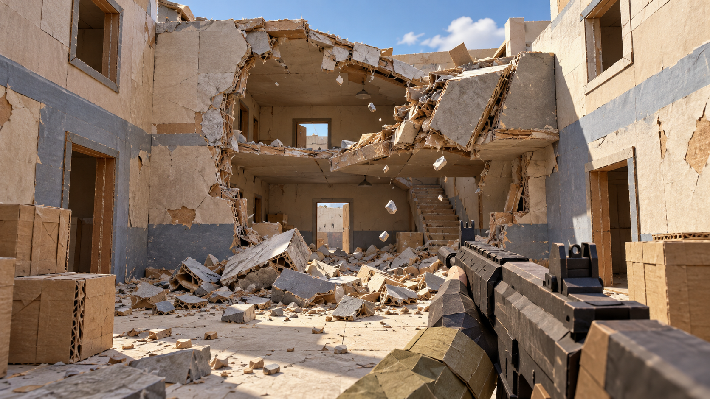

# 客户端设计

版本：v0.4 草案 · [返回总览](00-overview.md)

客户端负责输入、第一人称体验、状态展示和破坏渲染。服务器持有玩法真值；客户端负责及时反馈和正确呈现。[玩法规则](01-gameplay.md)与[通信约定](03-server.md)为本文件的上游定义。

## 1. 实现边界与组织

使用当前 UE C++ 工程，原生代码先保留在同一个 Runtime 模块中，Lua 作为项目脚本层，UnLua 作为待验证的第三方插件接入。以下为计划职责，不代表已有同名类。

| 职责 | 主要实现 | 内容 |
| --- | --- | --- |
| 输入与角色 | C++ 接入 Enhanced Input 与 CharacterMovement；Lua 处理离散操作意图及交互模式 | 移动预测、瞄准、射击请求、菜单／死亡时输入限制 |
| 武器与交互流程 | Lua 编排开火、换弹、投掷的本地流程；C++ 执行计时、插值和动画驱动 | 即时反馈、动作中断、确认／拒绝后的表现纠正 |
| 状态接收 | C++ 复制属性、RepNotify、事件接口 | 生命、弹药、比分、比赛阶段与重生状态 |
| 界面 | C++ 创建与布局原生 UMG 控件并提供接口；Lua 控制交互与显示流程 | 连接、HUD、结算和错误提示 |
| 破坏表现 | Lua 响应破坏事件并选择效果；C++ 管理 Geometry Collection、Niagara、音频及碎屑预算 | 展示权威结构与关键块，本地调度非交互碎屑 |
| 配置 | C++ 定义的 Data Asset／可编辑属性 | 武器表现、破坏资产、画质与预算参数 |
| 风格 Shader | 共享母材质／材质函数，必要的 Custom HLSL | 纸纹、纸芯层纹、手绘边缘及统一风格参数 |

核心状态变更经由服务端规则入口；客户端 Lua 通过原生接口提交操作请求，不自行决定扣血、加分、消耗权威弹药或结构是否断裂。

### Lua／UnLua 分工与接入

首版 Lua 负责客户端玩法控制器：将离散输入转成操作意图，编排本地武器／交互流程，处理死亡、重生、动作取消与服务器确认，并控制连接页、HUD 和结算页。C++ 提供角色移动预测、RPC 入口、复制声明、原生对象与控件、动画／镜头连续计算、Chaos 调度和渲染提交。逻辑按事件调用；开火等事件可进入 Lua，是否下沉 C++ 由实测成本决定，不按“每帧／非每帧”机械划分。

UnLua 可通过 UE 反射访问对象和绑定事件，但普通 Lua table 不会自动成为网络复制状态。客户端 Lua 保存本地动作与交互上下文，接收原生复制属性通知后更新流程；正式生命、弹药和比分以服务器复制值为准。大量对象的数据在 C++ 中批处理，脚本不逐帧遍历全部碎块或逐个调用 SetTransform。

建议脚本放在 Content/Script 下，按 Client、Server、Shared 分组：Client 包含玩法控制器、UI 与表现；Server 包含对局、战斗和重生规则；Shared 包含无端依赖的纯计算及通用定义。目录划分不会自动完成打包隔离。两端各有独立脚本执行状态，多个 PIE 世界也不得共享可变的玩家／比赛单例；共享代码不代表共享内存或权威结果。

原生 C++ 类通过 UnLua 接口绑定模块，C++ 调用规则回调，Lua 通过明确的原生接口请求操作，无需额外图形脚本层。窗口销毁、角色重生和地图切换时解除委托、停止计时器／协程并清理对象引用。客户端 Lua 错误记录调用栈并终止当前事件，权威状态继续由服务器维护。

接入验证顺序：固定插件提交与所带 Lua 版本 → 原生 C++ 类绑定 Lua，完成客户端请求、服务端规则计算、复制属性更新及客户端通知 → 原生 UMG 交互、多 PIE 世界与对象释放 → 独立 Client／Server 构建及实际分发包加载脚本。明确将两端所需脚本纳入打包，不能依赖开发机的松散 Content 目录。热重载仅作开发便利，在明确边界重建绑定；首版不做运行中在线分发脚本。

截至 2026-10-31，UnLua 官方资料未给出本项目 UE5.8.3 的完整验证结论，相关适配需通过上述原型确认；本次文档更新不表示插件已安装或可用。

## 2. 移动与第一人称表现

使用 ACharacter 和 CharacterMovementComponent 的移动预测、服务器校正与远端平滑。冲刺作为移动状态接入移动预测数据，不能只在客户端修改最大速度而不让服务器重现；先完成标准移动，再接入冲刺。

本地玩家使用第一人称镜头和武器表现，其他玩家通过第三人称身体表示位置与朝向。第一人称手臂／武器不承担权威命中碰撞。碰撞体、可见身体和服务器射击起点应保持合理对应，避免镜头穿墙产生不合理射击。

菜单开启、死亡和比赛阶段切换时统一更新输入允许状态。摄像机震动、后坐力和瞄准过渡只影响本地表现；正式射线和伤害仍按服务器校验后的瞄准信息计算。

## 3. 战斗输入与反馈

### 步枪

1. 客户端按本地配置限制开火节奏，生成 LifeId 范围内递增的 ShotId，并立即播放枪口、声音和后坐力。
2. 通过拥有者角色发送开火请求，字段与可靠性遵守服务端文档；不发送客户端计算的命中对象或伤害值。
3. 服务器验证后判定命中，并更新生命、弹药、死亡和得分等权威状态。
4. 客户端通过复制状态刷新 HUD；只有服务器确认的命中才显示正式命中提示。
5. 远端播放短暂开火效果。拥有者按角色、LifeId、ShotId 去重，避免本地预测与服务器事件重复播放。

首版只预测开火表现，不实现完整武器状态回滚。开火请求丢失或被拒绝时，允许本地出现一次无权威命中的预测开火；最终弹药和伤害以复制状态为准，不补造伤害。普通子弹使用射线，不为每发子弹生成持久复制 Actor。

### 换弹与手雷

换弹和投掷属于低频请求，由服务器确认角色状态、库存和冷却。手雷实体由服务器生成并控制引信，客户端接收其运动和爆炸结果。本地可以播放预备动作，但不自行决定手雷出生点、引爆时间或结构破坏。

换弹进度和重生倒计时使用服务器起止时间在客户端显示，避免每帧网络更新界面进度。死亡、切局等权威状态到达时，取消不再有效的动作表现。

## 4. 状态展示

| 数据 | 来源及呈现 |
| --- | --- |
| 比赛阶段、两队得分、结束时间 | GameState；所有客户端可见 |
| 队伍、击杀、死亡 | PlayerState；记分板使用 |
| 生命、存活、重生保护 | 角色／生命组件复制；驱动 HUD、角色表现 |
| 弹药、手雷库存、换弹状态 | 拥有者可见的权威属性 |
| 远端位置 | CharacterMovement 的复制与平滑 |
| 结构变化与关键残骸 | 破坏对象的权威状态及 Geometry Collection 复制 |
| 普通声音、火花、小碎屑 | 短暂事件／本地表现，不能充当持久状态 |

优先通过状态变化事件更新界面，不为每个 HUD 元素分别逐帧查询整个世界。连接失败、房间满员、对局已开始、版本不匹配和掉线应有可读提示；掉线返回连接入口，首版不自动恢复原玩家状态。

## 5. 破坏渲染

### 原生渲染路径

保留 Geometry Collection 对碎块的集合管理，避免每块碎片独立创建 Actor、组件并逐帧设置世界变换。普通 GPU 变换路径将碎块变换组成数组，GPU 按碎块索引读取；相关缓冲在支持的 RHI 上可轮换，减少写入与 GPU 读取冲突。

目标 PC 上优先测试启用 Nanite 的 Geometry Collection。其碎块变换、包围盒和几何层级进入 GPU Scene 实例数据，由 Nanite 进行相应的可见性与细节处理。Nanite 需要在资产和平台条件满足时实际启用，不因工程使用 UE5 就默认所有资产已经走该路径。

“GPU 变换池”仅作为集中存储并索引访问变换的解释性称呼，不作为项目新开发的引擎功能。普通 Collection 的局部变换表与 GPU Scene 的场景级实例数据管理不是同一个分配器。

### 视觉碎屑

重复砖块、石块可按网格和材质使用 ISM／实例池批量更新；形状独特的破碎构件继续使用 Geometry Collection。频繁运动的碎屑先评估 ISM，避免默认采用面向静态层级管理的 HISM。

视觉碎屑使用独立碰撞配置：可以与指定静态场景接触，但忽略玩家、武器查询与权威关键刚体，不向权威模拟反馈力。休眠、移除和生成限额可按客户端性能配置调整。关键结构与关键残骸的删除不能由本地视觉预算决定。

### 剩余开销

批量更新不能消除 CPU 整理、数据拷贝、GPU Scene 更新、材质、阴影及可能的光追结构更新成本。本机 UE 5.8.3 的原生动态数据路径会收集完整变换表；不能声称已经只上传变化碎块。

首版不修改渲染器做增量上传。先测试 Collection 的划分粒度、材质数量、小碎屑阴影、可见数量和寿命。只有变换整理／上传被证实为主要瓶颈时，才将局部更新列为扩展研究。

## 6. 纸模手绘 Shader

### 已选视觉基准

方向 A：立体纸模型，突出折面、纸纹、纸板层次与裁切边缘，手绘线条作为少量辅助。保持实体受光、投影和空间深度，不以全屏素描或重排线作为主要表现。

此图由内置 image_gen 生成，用于确定材质与造型方向，不代表已实现的画面、性能或同等细节承诺。[生成提示词](Assets/papercraft-direction-v1.prompt.txt)用于追溯方向；造型、材质与关卡资产共同实现纸模感，Shader 无法单独生成真实纸板厚度或改变断面轮廓。

### 材质分层与实现

| 层次 | 首版方法 | 与破坏的配合 |
| --- | --- | --- |
| 纸张表面 | 低金属感、高粗糙度；纸纤维纹理与轻微颜色／法线变化 | 使用稳定的资产 UV，碎块旋转时纹理跟随表面 |
| 折面与接缝 | 建模、法线和烘焙遮罩形成折面；材质强调明暗与印刷线条 | 折面属于资产设计，不依靠每帧改变几何制造全部细节 |
| 断面纸芯 | 破碎资产的内部面使用共享纸芯材质；用断面 UV／遮罩控制层纹 | 在生成 Geometry Collection 时准备内表面 UV、材质分段和方向 |
| 裁切与手绘边缘 | 通过制作好的边缘遮罩／顶点色叠加少量毛边、墨线和颜色不齐 | 远处减弱细节，避免密集碎块成为黑线噪声 |
| 整体风格 | 使用引擎现有受光路径，色调与曝光统一；后处理仅作辅助 | 保留真实遮挡关系和动态投影，优先维持目标可辨性 |

先用材质图和共享 Material Function 建立母材质，再将确需自定义的纸芯条带、纤维混合或边缘扰动写为局部 Custom HLSL；复用代码可放入项目 Shader 包含文件并配置路径与打包。Custom 节点不等于新增 Shading Model，也不保证比内置节点更快。首版不修改引擎光照模型，不用 Unlit 假光照替代全部受光来获得纸感。

对运动碎块优先使用烘焙 UV 和断面专用 UV。直接使用世界空间纸纹会出现纹理滑过碎块的问题；Collection 级局部坐标也不自动等于每个碎块的稳定局部坐标。层纹方向需要资产提供可靠依据。

统一通过材质实例、共享参数或适用的实例数据控制纸色、纤维尺度、层纹宽度、边缘强度和粗糙度，避免每个碎块创建独立动态材质实例。细纤维使用合适的纹理过滤／距离淡出，不逐帧随机扰动轮廓。可选屏幕描边必须按可见深度合成，不能透墙显示玩家；其插入阶段与时序抗锯齿配合需单独验证。

原型测试同一组完整墙、断裂内表面、旋转碎块、第一人称武器及角色，覆盖阴影中、强光下和远距离。验证当前项目材质配置与 Nanite／Geometry Collection 的实际兼容路径，检查断面 UV 拉伸、纸纹滑动、时序闪烁、武器拖影和角色可读性。

## 7. 性能与验证

使用固定分辨率、画质、相机路线和相同破坏输入。记录游戏线程、渲染线程、RHI、GPU 帧时间以及活动碎屑数量；若出现等待，需要确认等待的资源或任务，不能仅凭卡顿推断“GPU 被逐碎块更新阻塞”。

重点验证：拥有者开火不重复；远端移动可读；死亡后取消攻击表现；权威墙洞出现后能够通行和射击；视觉碎屑不产生单端卡人；连续破坏后数量与内存能够回落。

新增 Lua 调用次数、跨语言耗时及垃圾回收记录；检查多次打开关闭界面、重生和切局后是否出现重复回调或引用残留。Shader 使用同一破坏录像／输入对比启用前后 GPU 耗时，单独控制纸纹、纸芯、边缘和可选后处理，避免把材质成本与物理优化混算。

## 8. 参考

- [CharacterMovement 联网机制](https://dev.epicgames.com/documentation/en-us/unreal-engine/understanding-networked-movement-in-the-character-movement-component-for-unreal-engine)
- [Nanite 概述](https://dev.epicgames.com/documentation/unreal-engine/nanite-virtualized-geometry-in-unreal-engine)
- [ISM 与 HISM](https://dev.epicgames.com/documentation/unreal-engine/instanced-static-mesh-component-in-unreal-engine)
- [批量实例变换更新](https://dev.epicgames.com/documentation/unreal-engine/API/Runtime/Engine/UInstancedStaticMeshComponent/BatchUpdateInstancesTransforms)
- [UnLua 官方仓库与编程入口](https://github.com/Tencent/UnLua)
- [UnLua 原生类绑定与双向调用](https://github.com/Tencent/UnLua/blob/master/Docs/CN/UnLua_Programming_Guide.md)
- [UnLua UE5.7 适配 PR #771](https://github.com/Tencent/UnLua/pull/771)
- [Custom HLSL 材质表达式](https://dev.epicgames.com/documentation/en-us/unreal-engine/custom-material-expressions-in-unreal-engine)
- [后处理材质](https://dev.epicgames.com/documentation/unreal-engine/post-process-materials-in-unreal-engine)

