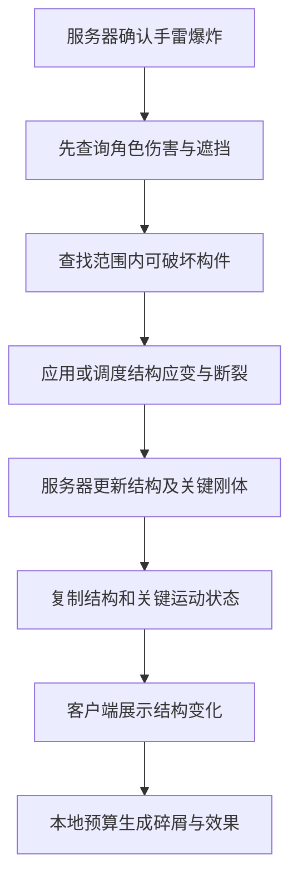

# 破坏系统设计

目标是在 4～8 人联机对局中实现可改变路线和掩体的实时破坏，同时控制连续爆炸时的物理、网络和渲染峰值。首版范围已确认：指定墙体、掩体和部分楼板可破坏，支持局部坍塌。

开发阶段以[总览第 6 节](00-overview.md#6-客户端与服务端开发路线图)为准：M4 完成手雷驱动的掩体、墙面、楼板、局部坍塌与纸模表现，并验证各端断裂、通行与射击阻挡一致性；M5 完成本文件规定的固定场景性能对照实验。每次结算后的地图重置成功，才允许实例承接新匹配。

## 1. 实现方式与职责分层

采用预破碎 Geometry Collection，在编辑阶段制作破碎层级、连接关系、碰撞与固定区域，运行时由权威攻击触发应变、断裂和刚体运动。不实时切割任意输入网格，不模拟任意建筑的通用结构力学。

| 层级 | 示例 | 模拟、同步与碰撞 |
| --- | --- | --- |
| 关键结构 | 墙面缺口、断裂楼板、可破坏支撑 | 服务器决定断裂；各端必须认可相同通行和射击阻挡状态 |
| 关键动态块 | 少量会挡路或挡子弹的大块残骸 | 服务器模拟并同步必要运动状态；数量受限，首版不造成砸伤 |
| 视觉碎屑 | 小石块、玻璃屑、扬尘 | 客户端本地表现；可按性能降级；不参与伤害、角色阻挡和武器查询 |

构件层级与表现资产应尽量在制作阶段分离，不能先把所有细碎块都变成权威交互对象，再只降低其网络更新频率。若关键动态块的碰撞同步不稳定，首版先取消相应残骸的玩家交互，保留结构缺口与倒塌表现。

服务端 Lua 决定玩法层面的破坏许可、损伤参数及断裂后的关卡事件；C++ 执行范围查询、Chaos 调度、求解与复制。客户端 Lua 根据已确认事件选择效果，C++ 批量管理碎屑和渲染数据。脚本接收构件级事件，不为每个接触点或碎块每步产生一次跨语言回调。

## 2. 资产制作与登记

1. 按墙段、楼板和局部支撑划分构件，避免整栋建筑成为一个无法限制释放规模的巨型簇。
2. 制作粗到细的破碎层级；粗层服务结构变化，细层服务视觉丰富度。
3. 配置锚定区域、连接关系和损伤传播，验证一次攻击的破坏半径与连锁范围。
4. 简化碰撞形状，减少细小凸面与碎屑间无意义接触；提前构建可以烘焙的连接数据。
5. 在关卡中为构件分配稳定、唯一的 DestructionId，登记资产版本／构建标识、允许破坏区域及表现配置。
6. 测试独立客户端与服务器上的断裂、角色通行和射击查询，再放入正式地图。

地图边界、出生区和保底承重结构不可破坏。每局重新加载地图恢复完整资产，不尝试在首版实现任意废墟反向拼回。

新增纸模资产要求：外表面具有稳定纸纹 UV，内部破碎面准备独立纸芯 UV／材质分段，裁切边缘与折面细节由模型和遮罩提供。纸芯条带应跟随碎块旋转，不采用会在运动时滑动的世界空间纹理作为默认方案。复用少量母材质及实例，不为每块碎片单独创建动态材质；视觉厚度与实际碰撞保持可接受对应。

## 3. 状态与数据契约

| 数据 | 作用 |
| --- | --- |
| RoundId、DestructionId | 定位当前对局中的构件，隔离上一局事件 |
| Revision | 构件关键结构变化的递增版本，用于去重、检查和诊断；不是每帧运动序号 |
| IntegrityState | 完整／局部破坏／整体破坏等粗粒度状态；供界面、规则和诊断使用 |
| 原生 Geometry Collection 状态 | 承载实际簇断裂与所需关键运动信息；粗粒度枚举不能替代它 |
| EventId、位置、强度、表现参数 | 标识服务器产生的破坏输入或短暂效果；不作为完整场景快照 |

结构状态与运动状态分开：一个已破坏构件可以仍在运动、已经休眠或被权威清除。改变玩法碰撞的移除操作由服务器决定；本地视觉碎屑的移除不推进关键结构 Revision。

首版优先复用 Geometry Collection 原生复制，不同时开发另一套完整的逐碎块位置协议。构件元数据用于明确规则和排查状态，不建立第二份互相矛盾的碰撞真值。需要在目标版本中验证复制层级、位置修正以及清理后的碰撞结果，未验证前不宣称网络问题已由引擎全部解决。

## 4. 一次破坏的执行流程

服务器产生唯一 EventId 并检查有效范围。结构断裂从权威结果复制到客户端，客户端不再对同一权威 Geometry Collection 重复施加一次伤害 Field，以免同时执行本地断裂和复制断裂。

爆炸位置和随机种子只能辅助表现，不能保证各端 Chaos 结果一致。会挡路或挡子弹的构件必须有权威状态与必要校正；纯视觉细节允许不同。

首版不允许中途加入，并使关键破坏对象保持网络相关。若后续支持中途加入、重连或空间裁剪，需要增加并验证“资产版本 + 当前断裂状态 + 关键块状态”的恢复快照；只重播临时 RPC 不足以恢复场景。

## 5. 物理优化方案

Chaos 刚体路径使用位置约束与速度约束的迭代求解，默认碰撞路径属于 Gauss–Seidel 类。相关刚体形成物理岛，组间可以并行。主要负载来自活跃刚体、接触点、约束图变化与迭代工作；模型面数或总碎块数不能单独代表求解成本。

首版以三项可验证工作为重点：

| 工作 | 实现内容 | 质量约束 |
| --- | --- | --- |
| 断裂分批与释放规模控制 | 使用原生每次推进断裂限额作为基线；通过资产层级控制单簇释放规模；必要时增加项目级请求优先级 | 关键结构不能漏处理，等待延迟必须记录并限制 |
| 活跃数量与生命周期 | 统计关键块和视觉刚体；细碎屑优先休眠、禁用或移除；限制持续生成 | 不由客户端预算删除玩法碰撞；不能用一段持续卡顿替代一次尖峰 |
| 分级同步 | 关键结构与少量大块保持权威；纯视觉碎屑本地生成 | 通行、射击阻挡、比赛伤害保持一致 |

### 原生断裂限额

UE 5.8.3 源码存在以下设置与同名后缀控制台变量：

| 设置 | 控制台变量 | 含义 |
| --- | --- | --- |
| PerAdvanceBreaksAllowed | p.Chaos.Clustering.PerAdvanceBreaksAllowed | 单次 AdvanceClustering 允许处理的断裂数量 |
| PerAdvanceBreaksRescheduleLimit | p.Chaos.Clustering.PerAdvanceBreaksRescheduleLimit | 未处理项中允许重新排入后续处理的数量 |

它们按物理推进计数，不一定等于渲染帧；限制的不是碎块数量或毫秒数。一个簇仍可能释放很多碎块，队列限制也不是最大等待时长或无损保留保证。实验必须检查是否遗漏关键断裂，不能仅观察峰值下降。

项目级调度若需要实现，应先对关键结构和视觉任务分类，再按重要性、等待时间及预计释放规模排序。关键任务保留并追踪结果，低优先级视觉任务可以合并或取消；每次任务仍有最小处理粒度，不承诺可在任意毫秒处中断。

### 不能直接分摊的工作

不把同一物理岛中尚未完成的旧接触约束留到世界已经推进后的下一步继续求解。异步物理可与渲染重叠，但不会消除计算量；子步进通常增加求解次数，不能直接当作削峰开关。

优先降低活动对象和接触数量，再调整迭代次数、步长或异步配置。降低迭代次数的实验需同时测量穿透、抖动与堆叠稳定性。首版不修改底层求解算法，也不为全部碎块引入预测回滚。

## 6. 渲染与网络预算

渲染复用原生变换数组、GPU 变换索引及适用的 Nanite／GPU Scene 路径，详见[客户端设计](02-client.md)。不将“新建 GPU 变换池”写作首版研发成果；引擎已有的批量上传与缓冲轮换作为基线。

新增纸模 Shader 在原生渲染路径上工作，优先保证外表面、破碎内表面和运动碎块风格一致。纸芯纹理、额外材质分段、边缘效果及阴影分别测量；不为了纸感给全部碎块添加额外壳层网格或逐帧形变。客户端 Lua 可触发表现事件或调整共享风格参数，但不进入逐碎块求解、变换上传与复制循环。

需要分别配置并测量：关键动态块上限、客户端活动视觉刚体预算、视觉寿命、每步断裂限额、待处理数量与等待时长、关键块复制频率、材质／阴影负担。具体数值由目标硬件基线确定，不能互相替代。

若希望先打开通道、再分批出现碎屑，需要专门设计权威碰撞与视觉表现分离。原生断裂限额只是推迟断裂处理，不会自动提供这项功能。首版优先让结构变化的生效时间由服务器统一决定。

## 7. 实验与验收

准备三类固定测试：单构件爆炸、多处同时爆炸、持续触发新构件破坏并观察残骸堆积。测试脚本与正常玩法分离，可重复施加相同输入，不受一枚手雷库存限制。

每次记录地图、资产版本、硬件、进程分布、物理步长、迭代次数、画质与客户端数量。恢复同一初始场景，固定攻击序列和相机路线，预热后重复至少五次；随机种子固定不意味着物理轨迹必然完全一致。

| 方案 | 与原始配置的区别 |
| --- | --- |
| A：原生基线 | 保留引擎默认机制，固定实验配置 |
| B：断裂调度 | 只改变断裂限额／释放组织 |
| C：生命周期 | 只增加休眠、移除与活动数量控制 |
| D：同步分层 | 只改变非玩法碎屑的同步策略，保持关键结构行为 |
| E：组合方案 | 合并已验证有效的改动，检查收益是否仍成立 |

记录客户端与服务器的 P95/P99 耗时、峰值、超时次数，物理接触与活动刚体数量、断裂队列长度／等待时长、每客户端与服务器总流量，以及内存是否回落。渲染优化另行固定物理配置做对照，避免混淆收益来源。

质量验收同时检查：墙洞两端可通行、子弹遮挡一致、关键块没有明显持续漂移、视觉碎屑不挡人、关键断裂不丢失、地图重置无残留。若降低耗时但破坏延迟、漏处理或碰撞错误增加，应记录为取舍，不能只报告性能提升。

实验结果模板：

| 场景／方案 | 服务端物理 P99 | 客户端帧时间 P99 | 关键结构响应延迟 | 网络发送量 | 一致性／稳定性 | 结论 |
| --- | --- | --- | --- | --- | --- | --- |
| 待测 | — | — | — | — | — | 不填写预估提升比例 |

## 8. 依据与实现核对点

- [Chaos 破坏与 Geometry Collection](https://dev.epicgames.com/documentation/en-us/unreal-engine/destruction-quick-start)
- [Chaos 性能实践](https://dev.epicgames.com/community/learning/tutorials/KWeX/unreal-engine-a-tech-artist-s-playbook-for-chaos-performance)
- [物理设置与异步／子步进](https://dev.epicgames.com/documentation/unreal-engine/physics-settings-in-the-unreal-engine-project-settings)
- [Geometry Collection 组件](https://dev.epicgames.com/documentation/unreal-engine/API/Runtime/GeometryCollectionEngine/UGeometryCollectionComponent)

本文涉及的机制已在本机 UE 5.8.3 源码中核对，但尚未在项目场景中完成性能或联机验证。实现时主要检查引擎中的 PBDRigidClustering.cpp、ChaosSolverConfiguration.h、ConstraintGroupSolver.cpp、GeometryCollectionComponent.cpp 与 GeometryCollectionSceneProxy.cpp；升级补丁版本后重新确认相关行为。

